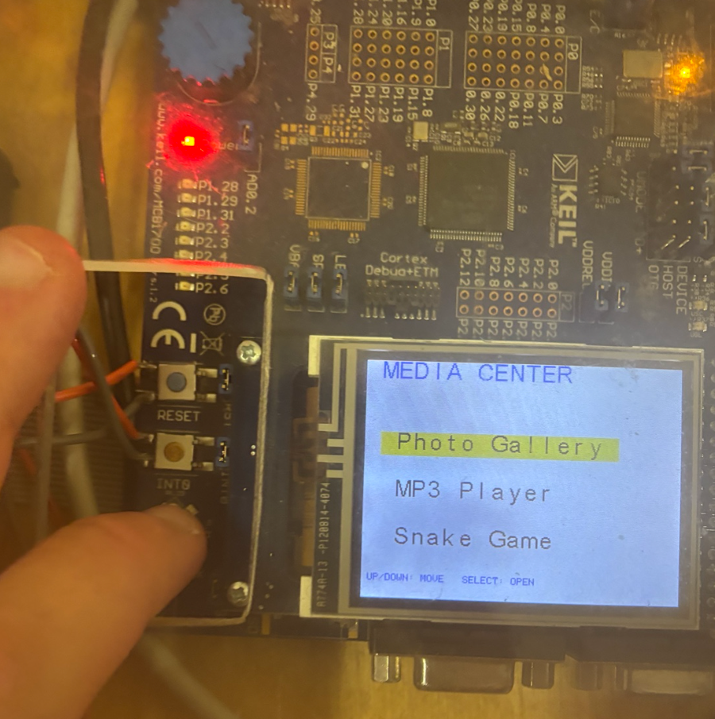
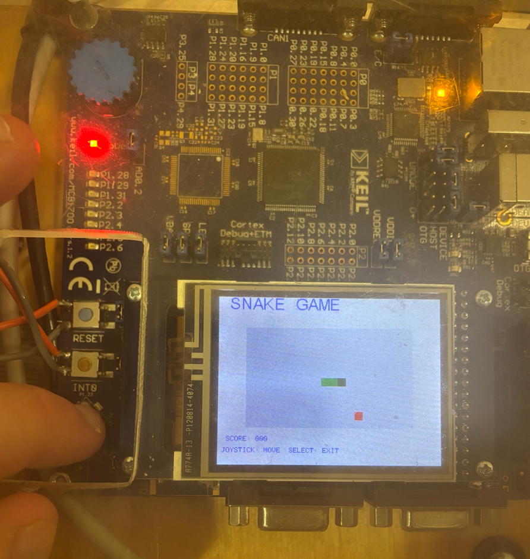
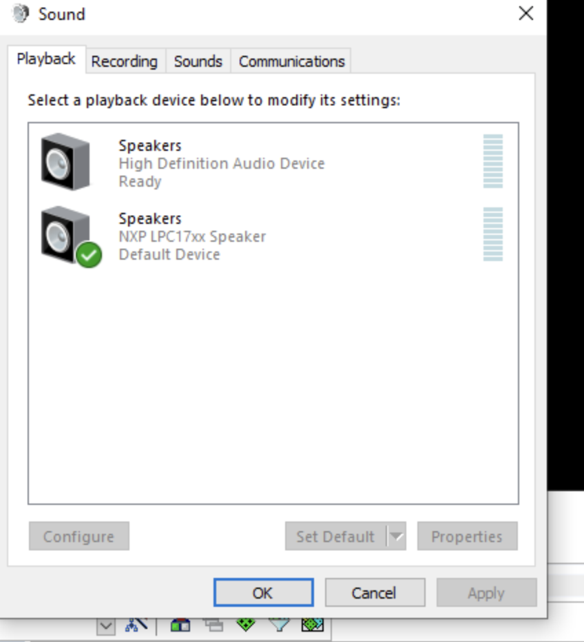
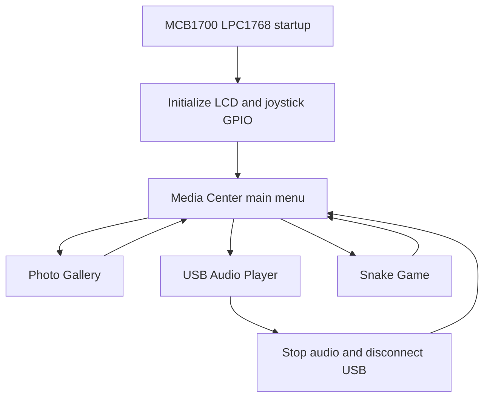

# LPC1768 Embedded Media Center

**Embedded C | ARM Cortex-M3 | NXP LPC1768 | Keil MCB1700 | Keil µVision**

A joystick-controlled multimedia interface developed on the Keil MCB1700 evaluation board as a Computer Engineering embedded-systems project. The application brings together a Photo Gallery, PC-streamed USB audio, and a playable Snake Game.

## Hardware demonstration

| Media Center menu | Snake Game |
| :---: | :---: |
|  |  |

**USB audio device recognized in Windows**

## Features

- **Joystick and graphical LCD:** Navigate the main menu with GPIO-based UP/DOWN input and launch an application using SELECT.
- **Photo Gallery:** Browse three 160 × 120 images using RGB565 bitmap arrays drawn with `GLCD_Bitmap()`.
- **Snake Game:** 20 × 12 grid; joystick movement, body growth, randomly positioned food, score tracking, wall/self-collision checks, and game-over handling.
- **USB Audio Player:** Audio streamed from a Windows PC to the board as an NXP LPC17xx USB speaker. The board potentiometer controls volume using an ADC measurement and DAC-based output path. Pressing SELECT disconnects the audio device.
- **Mode switching:** Each application exits back to the menu without resetting the microcontroller.

## Architecture

## Technical details

| Item | Implementation |
| --- | --- |
| Microcontroller | NXP LPC1768, ARM Cortex-M3 |
| Board | Keil MCB1700 |
| Toolchain | Keil µVision, ARM Compiler 5 |
| Language | C |
| Input | GPIO joystick, ADC potentiometer |
| Output | Graphical LCD, DAC/audio, USB Audio Class device |
| Gallery | 3 images, 160 × 120 pixels, RGB565 |
| Snake | 20 × 12 cells, 12 × 12 pixels per cell |
| Final integrated build | 0 errors, 0 warnings (on original project) |

## Repository contents

- [`src/Blinky.c`](src/Blinky.c): Main application; joystick, menu, gallery, and Snake logic, plus calls to the audio interface.
- [`src/MediaAudio.h`](src/MediaAudio.h): Integration interface for starting/stopping USB audio.
- [`media/`](media/): Photographs and Windows USB playback screenshot from the hardware test.
- [`docs/implementation-notes.md`](docs/implementation-notes.md): Module explanations and build/dependency limitations.

### Important: source excerpt, not a standalone firmware build

This public-facing portfolio repository intentionally contains **only the project-specific application source and documentation**. It does **not** contain the entire Keil project, proprietary/vendor-supplied USB Audio example, LCD/USB drivers, device startup code, binary artifacts, or original gallery image assets whose redistribution rights have not been confirmed. Consequently, `Blinky.c` cannot be built directly from this repository alone.

To reproduce the full firmware, a developer would need a suitably licensed Keil/ARM development environment and compatible MCB1700 examples/drivers, the relevant RGB565 image arrays, and the original Keil project configuration (including USB DMA linker/scatter settings). See the [implementation notes](docs/implementation-notes.md).

## Verification

The integrated firmware was tested on the MCB1700 development board. Observed behavior included menu navigation, gallery browsing, Snake controls, Windows detecting `NXP LPC17xx Speaker`, audio playback through the board, potentiometer-based volume adjustment, and disconnection/reconnection when leaving/reopening the audio mode.

## Attribution

Built as a university embedded-systems project. The USB, LCD, startup, and other support components were adapted from course-provided Keil/ARM examples and are **not redistributed here**. Their respective owners retain their copyrights.

**No license is granted by this repository for third-party code or assets.**
